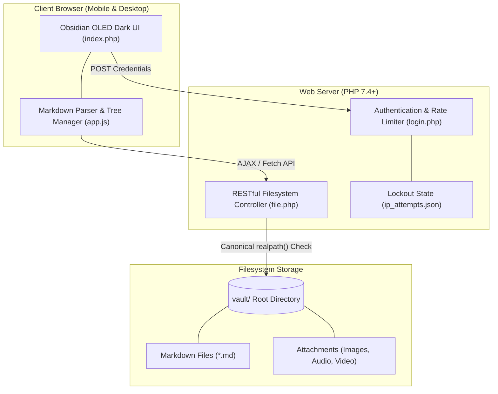

# 🔮 Obsidian Vault Web Viewer & Editor

> A lightweight, zero-dependency, self-hosted PHP & JavaScript web interface for viewing, editing, and managing your [Obsidian](https://obsidian.md/) vault across desktop and mobile devices.

[](https://www.php.net/)
[](https://obsidian.md/)
[-success?style=for-the-badge)](https://developer.mozilla.org/en-US/docs/Web/JavaScript)
[](LICENSE)

---

## ✨ Features

- **📱 Authentic Obsidian Aesthetics**: Pitch-black (`#000000`) OLED dark theme matching native Obsidian mobile & desktop applications.
- **🔐 Dual-Mode Authentication System**:
  - **Read-Only Mode**: Safe view mode for browsing notes without edit permissions.
  - **Edit Mode**: Full vault access to create, edit, rename, move, and delete files & folders.
- **📝 Live Markdown & Media Parser**:
  - Wikilink image embeds (`![[image.jpg]]`, `![[image.jpg|300]]`).
  - Audio & video embeds (`![[recording.m4a]]`, `![[video.mp4]]`).
  - Auto-generated note titles, headings (`#`, `##`, `###`), horizontal dividers (`---`), lists, and inline formatting.
- **🖼️ Native File Explorer & Drag & Drop Uploads**:
  - Insert images and audio directly into notes using your device's native file picker (`🖼️ Insert Image`, `🎵 Insert Audio`).
  - Drag and drop image files directly onto the editor textarea to automatically upload and embed them.
- **🚚 Drag & Drop File & Folder Moving**:
  - Drag items in the sidebar tree onto target folders to move them instantly.
  - Mobile-optimized move button (`⇄`) with custom in-app folder selector modal.
- **🎨 Custom In-App Modal Dialog System**:
  - Custom dark-mode dialogs for prompts and confirmations, ensuring 100% compatibility across mobile browsers where native `prompt()` is blocked.
- **🛡️ Built-in Security & Rate Limiting**:
  - IP-based rate limiting (5 failed login attempts trigger a 30-minute lockdown).
  - Canonical `realpath()` path validation preventing directory traversal attacks outside `/vault`.

---

## 🏗️ System Architecture



---

## 🔒 Security & Password Configuration

> [!IMPORTANT]
> **Password Configuration Required**:
> For security reasons, default password hashes must be configured in `login.php` on **lines 12 and 13**.

To generate a custom password hash for your vault, run the following PHP snippet:
```bash
php -r "echo password_hash('YOUR_NEW_PASSWORD', PASSWORD_BCRYPT) . PHP_EOL;"
```

Then update `login.php`:
```php
// Lines 12 & 13 in login.php:
$readonly_hash = password_hash('YOUR_READONLY_PASSWORD', PASSWORD_BCRYPT);
$edit_hash     = password_hash('YOUR_EDIT_PASSWORD', PASSWORD_BCRYPT);
```

### Security Highlights
1. **Password Hash Verification**: Passwords are validated using PHP's `password_verify()` against stored Bcrypt hashes.
2. **Session Locking**: All modification endpoints (`action=save`, `action=upload`, `action=move`, `action=delete`, `action=rename`, `action=create_file`, `action=create_folder`) strictly enforce `$_SESSION['mode'] === 'edit'` and return `403 Forbidden` otherwise.
3. **Path Traversal Protection**: All filesystem accesses resolve through canonical `realpath()` checks, ensuring no requests can read or write outside the designated `vault/` root directory.
4. **Brute-Force Protection**: IP attempts are tracked in `ip_attempts.json`. Reaching 5 invalid attempts locks out the IP address for 1800 seconds (30 minutes).

---

## 🚀 Installation & Setup

### Requirements
- **Web Server**: Apache, Nginx, LiteSpeed, Caddy, or PHP Built-in Server.
- **PHP**: PHP 7.4 or PHP 8.x with `json` and standard file system extensions enabled.
- **Database**: None required (uses standard server filesystem).

### Quick Start (Production Server)
1. Clone the repository into your web server document root:
   ```bash
   git clone git@github.com:kersonik/obsidian-web.git
   cd obsidian-web
   ```

2. Set proper directory permissions for the `vault/` directory so PHP can save notes and uploaded media:
   ```bash
   mkdir -p vault
   chmod -R 775 vault
   ```

3. Open your web browser and navigate to `http://your-domain.com/login.php`.

### Local Development / Quick Test
You can start a temporary local server in seconds without installing Apache or Nginx:

```bash
php -S 0.0.0.0:8000
```
Then navigate to `http://localhost:8000/login.php` in your browser.

---

## 📁 Repository Structure

```
obsidian-web/
├── index.php          # Main HTML structure, Obsidian dark CSS, modal backdrops
├── app.js             # Markdown parser, AJAX file tree renderer, editor sync, Drag & Drop
├── file.php           # RESTful PHP backend API & file server with path validation
├── login.php          # Responsive login interface, Bcrypt hash checks & IP rate limiting
├── ip_attempts.json   # Auto-generated rate limiting tracker (ignored in git)
└── vault/             # Obsidian Markdown notes and attachments directory
    ├── Note.md
    └── attachments/
```

---

## 📡 Backend API Reference (`file.php`)

| Method | Endpoint / Action | Description | Required Mode |
| :--- | :--- | :--- | :--- |
| `GET` | `file.php?action=list` | Returns full JSON directory tree of the vault | Authenticated |
| `GET` | `file.php?f=path/to/note.md` | Serves file content with proper MIME type headers | Authenticated |
| `POST` | `file.php?action=save` | Saves edited note content (`f`, `content`) | **Edit Mode** |
| `POST` | `file.php?action=upload` | Uploads attachment file via native explorer | **Edit Mode** |
| `POST` | `file.php?action=move` | Moves file/folder to target directory (`sourcePath`, `targetFolder`) | **Edit Mode** |
| `POST` | `file.php?action=create_file` | Creates a new Markdown file (`name`, `parent`) | **Edit Mode** |
| `POST` | `file.php?action=create_folder` | Creates a new directory (`name`, `parent`) | **Edit Mode** |
| `POST` | `file.php?action=rename` | Renames file or directory (`oldPath`, `newName`) | **Edit Mode** |
| `POST` | `file.php?action=delete` | Recursively deletes file or directory (`path`) | **Edit Mode** |

---

## ⌨️ Keyboard Shortcuts

| Shortcut | Action |
| :--- | :--- |
| `Ctrl + S` / `Cmd + S` | Instantly save current note to server |
| `Escape` | Close active custom modal dialog |
| `Enter` | Confirm action in custom modal dialog |

---

## 📄 License

Distributed under the [MIT License](LICENSE). Built with ❤️ for Obsidian note takers.
