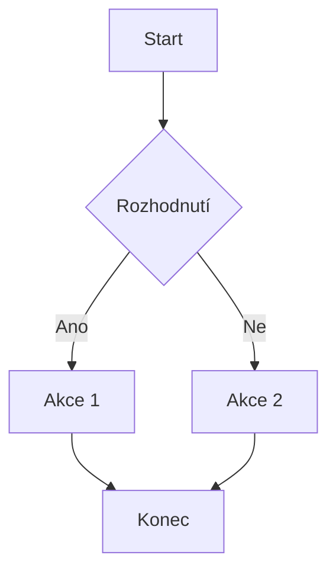

# Testovací poznámka

Toto je testovací poznámka s **kompletními Obsidian funkcemi**.

---

## Formátování textu

Toto je **tučný text**, *kurzíva*, ~~přeškrtnutý text~~ a ==zvýrazněný text==.

Inline kód: `console.log("Ahoj")` a <kbd>Ctrl+S</kbd> pro uložení.

<font color="red">Červený text</font> a <font color="cyan">azurový text</font> a <font color="#ff9100">oranžový text</font>.

Dolní index: H<sub>2</sub>O a horní index: E=mc<sup>2</sup>.

---

## Nadpisy

### Nadpis 3
#### Nadpis 4
##### Nadpis 5
###### Nadpis 6

---

## Callouts / Poznámky

> [!NOTE] Poznámka
> Toto je poznámka s důležitou informací.
> Může být víceřádková.

> [!WARNING] Upozornění
> Buďte opatrní s tímto nastavením!

> [!TIP] Tip
> Zde je užitečný tip pro každodenní práci.

> [!IMPORTANT] Důležité
> Toto je kritická informace.

> [!BUG] Bug
> Nalezená chyba v systému.

> [!SUCCESS] Úspěch
> Operace byla úspěšně dokončena.

> [!EXAMPLE] Příklad
> Zde je příklad použití.

> [!QUESTION] Otázka
> Jak to vlastně funguje?

---

## Blokový citát

> Toto je blokový citát
> se dvěma řádky

---

## Úkoly / Checkboxes

- [ ] Nedokončený úkol
- [x] Dokončený úkol
- [ ] Další nedokončený úkol
- [x] Další hotový úkol

---

## Seznamy

### Neuspořádaný seznam
- První položka
- Druhá položka
- Třetí položka

### Uspořádaný seznam
1. První krok
2. Druhý krok
3. Třetí krok

---

## Tabulky

| Jméno | Věk | Město |
|:---|:---:|---:|
| Jan | 25 | Praha |
| Marie | 30 | Brno |
| Petr | 28 | Ostrava |

---

## Bloky kódu

```javascript
function pozdrav(jmeno) {
    console.log(`Ahoj, ${jmeno}!`);
    return true;
}

pozdrav("Světe");
```

```python
def fibonacci(n):
    a, b = 0, 1
    for _ in range(n):
        yield a
        a, b = b, a + b

print(list(fibonacci(10)))
```

```css
.obsidian-theme {
    --bg-main: #000000;
    --accent: #7f6df2;
    color: var(--accent);
}
```

---

## Mermaid diagram



---

## Matematika / LaTeX

Inline vzorec: $E = mc^2$

Blokový vzorec:

$$
\int_{0}^{\infty} e^{-x^2} dx = \frac{\sqrt{\pi}}{2}
$$

---

## Tagy

Toto je poznámka s #tag a #projekt/webovy a #todo tagy.

---

## Odkazy

### Wiki linky
Odkaz na [[jinou poznámku]] a [[poznámka|s vlastním textem]].

### Standardní linky
[Google](https://www.google.com) a [Obsidian](https://obsidian.md)

---

## Poznámky pod čarou

Toto je text s poznámkou pod čarou[^1] a druhou poznámkou[^2].

[^1]: Toto je první poznámka pod čarou.
[^2]: Toto je druhá poznámka s více informacemi.

---

## Vykreslování SVG (Inline Vector Graphics)

Níže je přímý vektorový SVG diagram vykreslený přímo v poznámce:

<svg width="340" height="120" viewBox="0 0 340 120" xmlns="http://www.w3.org/2000/svg">
  <defs>
    <linearGradient id="grad1" x1="0%" y1="0%" x2="100%" y2="100%">
      <stop offset="0%" style="stop-color:#7f6df2;stop-opacity:1" />
      <stop offset="100%" style="stop-color:#00bfa5;stop-opacity:1" />
    </linearGradient>
  </defs>
  <rect x="10" y="15" width="90" height="50" rx="8" fill="url(#grad1)" stroke="#a882ff" stroke-width="2"/>
  <text x="55" y="45" fill="#ffffff" font-size="13" font-family="sans-serif" text-anchor="middle" font-weight="bold">Start</text>
  <line x1="100" y1="40" x2="150" y2="40" stroke="#7f6df2" stroke-width="3" />
  <circle cx="180" cy="40" r="28" fill="#1e1e24" stroke="#7f6df2" stroke-width="2"/>
  <text x="180" y="44" fill="#a882ff" font-size="12" font-family="sans-serif" text-anchor="middle">SVG Graf</text>
  <line x1="210" y1="40" x2="260" y2="40" stroke="#00bfa5" stroke-width="3" />
  <rect x="260" y="15" width="70" height="50" rx="8" fill="#00bfa5" fill-opacity="0.2" stroke="#00bfa5" stroke-width="2"/>
  <text x="295" y="45" fill="#00bfa5" font-size="13" font-family="sans-serif" text-anchor="middle" font-weight="bold">Cíl</text>
</svg>

Vložený SVG soubor pomocí `![[diagram.svg]]`:

![[diagram.svg]]

---

## Barvičky textu

Různé způsoby barevného stylování v poznámkách:

- Markdown barvičky: [Zelený text]{color: #50fa7b} a [Červený text]{color: #ff5555} a [Fialový text]{#bd93f9}
- HTML font color: <font color="#8be9fd">Azurová</font>, <font color="#ffb86c">Oranžová</font>, <font color="#f1fa8c">Žlutá</font>
- HTML span style: <span style="color: #ff79c6; font-weight: bold; text-shadow: 0 0 8px rgba(255,121,198,0.4);">Růžový zářící text</span>
- Obsidian zvýraznění: ==Zářivě žluté zvýraznění textu==

---

## Vnořená poznámka (Transclusion)

Transkluze jiné poznámky:

![[Vítejte v Obsidianu]]

---

## Skryté komentáře

%%Tento text nebude zobrazen%%

Text po komentáři je viditelný.
